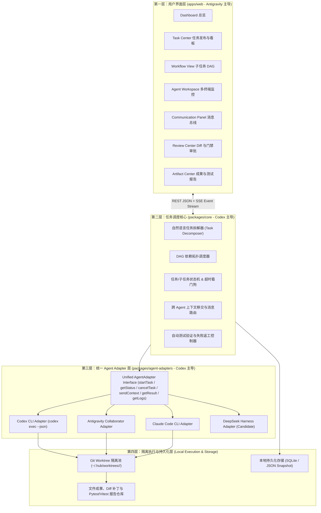

# 系统总体技术架构（`docs/architecture.md`）

**文档版本：** V1.0  
**系统定位：** 本地优先、跨厂商、可扩展的多 AI Agent 自主协作平台

---

## 一、四层架构设计

---

## 二、核心闭环工作流

1. **任务发布（Task Creation）：** 用户输入一条自然语言需求（如*“开发一个基于 Python 的智能车视觉识别系统，要求实现赛道识别、障碍物检测、测试验证，并生成完整开发文档”*）。
2. **自动拆解（Decomposition）：** 系统将需求分解为具备有向无环图（DAG）依赖关系的多个子任务（`SUB-01` 架构与接口定义 → `SUB-02` 赛道识别 & `SUB-03` 障碍物检测并行研发 → `SUB-04` 集成测试验证 → `SUB-05` 完整开发文档）。
3. **能力匹配与 Worktree 隔离分配（Dispatch & Isolation）：** 调度器按阶段能力将子任务分配给最合适的 Agent，并为每个子任务创建独立的 Git Worktree 分支，杜绝多 Agent 同时修改同一工作区造成的文件踩踏。
4. **上下文传递（Context Handoff）：** 上游子任务完成后，其产出的接口文件、Commit SHA 与摘要通过 `MessageBus` 自动注入下游子任务的工作上下文。
5. **质量门禁与失败返工（Quality Gate & Rework）：** 测试子任务或人工审核发现缺陷（或断言失败）时，系统自动将任务流转为 `reworking`，附带结构化错误日志打回给原执行 Agent 进行修复重试。
6. **成果交付与可追溯归档（Delivery & Traceability）：** 所有代码补丁、测试覆盖率报告、开发文档及完整通信历史集中归档于 `Artifact Center`。
