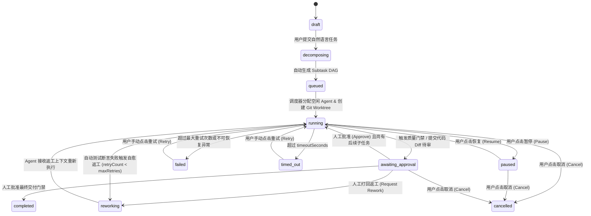

# 前端对后端的数据与接口需求说明（`docs/frontend-api-requirements.md` — 任务 A-03）

**文档版本：** V1.0  
**提出方：** Antigravity（首席前端工程师）  
**接收方：** OpenAI Codex（首席后端工程师 + Agent 编排引擎负责人）  
**关联类型定义：** [`packages/shared/src/types.ts`](../packages/shared/src/types.ts)

---

## 一、核心原则

1. **厂商无关的结构化输出：** 前端不解析任何特定 Agent（如 Claude、Codex、Gemini）的私有终端控制符或非标准输出，后端 `AgentAdapter` 必须将各 CLI 的输出归一化为本文档定义的 7 大核心实体与增量事件。
2. **显式区分模拟与真实运行：** 每一个返回的实体都必须包含 `executionMode: 'mock' | 'live'`，以便前端在 UI 上展示明确标签，防止将未接通真实子进程的 Mock 数据误认为真实执行结果。
3. **支持断点重连与防丢包：** 前端在多页面切换或浏览器刷新时，通过 `GET /api/state` 获取一致性快照，并通过 `GET /api/stream?cursor=<lastEventId>` 订阅实时增量事件。

---

## 二、七大核心实体字段需求

完整 TypeScript 定义已落盘于 `packages/shared/src/types.ts`，以下为各实体前端强依赖的关键字段说明：

### 1. `Task`（顶层协同任务）
- **标识与输入：** `id`, `title`, `prompt`, `priority` (`low` | `medium` | `high` | `critical`), `executionMode` (`mock` | `live`)
- **Git 隔离基准：** `repoPath`, `baseBranch`, `baseCommit`
- **状态与进度：** `status` (`draft` | `decomposing` | `queued` | `running` | `awaiting_approval` | `reworking` | `paused` | `completed` | `failed` | `cancelled` | `timed_out`), `progressPct` (0-100)
- **关联聚合：** `subtaskIds: string[]`, `activeAgentIds: string[]`, `pendingApprovalCount: number`
- **容错与计时：** `retryCount`, `maxRetries`, `timeoutSeconds`, `createdAt`, `updatedAt`, `startedAt`, `completedAt`, `error?: StructuredError | null`

### 2. `Subtask`（拆解后的子任务节点与 DAG 边）
- **标识与归属：** `id`, `taskId`, `code` (如 `"SUB-01"`), `title`, `description`, `stage` (`analysis` | `implementation` | `testing` | `review` | `documentation`)
- **DAG 依赖字段：** `dependsOn: string[]`（前置子任务 ID 数组，前端据此渲染 DAG 连线与阻塞状态）
- **分配与隔离：** `assignedAgentId`, `worktreePath` (如 `~/.hub/worktrees/task-1/sub-02`), `branchName` (如 `hub/task-1/sub-02-lane`)
- **执行与验收：** `status` (`pending` | `ready` | `running` | `review` | `reworking` | `completed` | `failed` | `blocked` | `skipped`), `progressPct`, `retryCount`, `acceptanceCriteria: string[]`, `outputArtifactIds: string[]`, `error?: StructuredError | null`

### 3. `Agent`（执行者与能力画像）
- **标识与角色：** `id`, `name`, `roleTitle`, `provider` (`codex-cli` | `antigravity` | `claude-code` | `gemini-cli` | `deepseek-harness`)
- **本地调用与合规认证：** `cliCommand`, `authMethod` (`local_cli_session` | `sdk_login` | `env_token_optional`), `version`
- **运行态与能力：** `status` (`idle` | `busy` | `offline` | `error` | `rate_limited`), `capabilities: string[]`, `supportedStages`, `currentTaskId`, `currentSubtaskId`, `activeWorktree`, `maxConcurrency`, `executionMode`

### 4. `AgentRun`（单次 Agent 进程执行实例）
- **关联上下文：** `id`, `taskId`, `subtaskId`, `agentId`, `executionMode`
- **进程与隔离详情：** `status` (`running` | `succeeded` | `failed` | `cancelled` | `timed_out`), `pid`, `tmuxSession`, `worktreePath`, `branchName`, `commandLine`
- **时间与退出码：** `startedAt`, `endedAt`, `durationMs`, `exitCode`
- **结构化日志流：** `logLines: Array<{ timestamp: string; stream: 'stdout' | 'stderr' | 'system'; text: string }>`
- **错误详情：** `error?: StructuredError | null`

### 5. `Message`（Agent 间通信与共享上下文记录）
- **路由标识：** `id`, `taskId`, `subtaskId`, `fromAgentId` (Agent ID 或 `"user"` / `"orchestrator"`), `toAgentId` (目标 Agent ID 或 `"all"` / `"user"`), `executionMode`
- **语义分类：** `type` (`task_decomposition` | `context_handoff` | `tool_execution` | `review_feedback` | `approval_request` | `rework_instruction` | `error_alert` | `human_directive`)
- **消息载荷：** `summary`, `content`, `createdAt`
- **上下文引用：** `sharedContextRefs?: { files?: string[]; commitSha?: string; artifactId?: string }`

### 6. `Artifact`（生成成果与测试报告）
- **元数据：** `id`, `taskId`, `subtaskId`, `producerAgentId`, `executionMode`, `name`, `path`, `category` (`code` | `diff` | `test_report` | `documentation` | `config`), `mimeType`, `sizeBytes`, `createdAt`
- **内容预览与结构化摘要：**
  - `previewContent: string`
  - `testSummary?: { total: number; passed: number; failed: number; coveragePct: number }`
  - `diffStats?: { filesChanged: number; insertions: number; deletions: number }`

### 7. `Approval`（人工审核与质量门禁请求）
- **标识与门禁类型：** `id`, `taskId`, `subtaskId`, `requestedByAgentId`, `executionMode`, `gateType` (`plan_signoff` | `code_diff_review` | `test_verification` | `final_delivery`)
- **审核内容与结果：** `title`, `description`, `status` (`pending` | `approved` | `rejected` | `rework_requested`), `diffPreview`, `testReportArtifactId`, `createdAt`, `resolvedAt`, `reviewerComment`

---

## 三、统一结构化错误字段（`StructuredError`）

前端需要明确的错误枚举以便渲染对应的恢复按钮（重试、切换 Agent、检查 CLI 登录）：

```json
{
  "code": "AGENT_TIMEOUT",
  "message": "Subtask SUB-03 (Obstacle Detection) exceeded timeout of 180s without stdout heartbeat.",
  "recoverable": true,
  "suggestedAction": "Retry subtask in clean worktree or increase timeout to 300s.",
  "occurredAt": "2026-11-02T05:50:12.000Z",
  "subtaskId": "sub-103",
  "agentRunId": "run-503",
  "rawExitCode": 124
}
```

支持的错误码枚举：
- `AGENT_TIMEOUT`：执行超时（前端展示“重试并延长超时”按钮）
- `CLI_NOT_FOUND`：本地未找到对应 CLI 二进制（前端引导跳往 Settings 查看安装命令）
- `AUTH_REQUIRED`：CLI 会话未登录或过期（前端提示用户在终端执行官方登录命令，不收集任何非授权凭证）
- `WORKTREE_CONFLICT`：Git 分支或 Worktree 冲突（前端提供“重置隔离分支并重试”按钮）
- `TEST_ASSERTION_FAILED`：自动化测试未通过（前端提供“一键触发 Agent 返工 (Rework)”按钮）
- `DEPENDENCY_FAILED`：前置子任务失败导致阻塞
- `RATE_LIMITED`：调用频率受限
- `PROCESS_CRASHED`：子进程非零异常退出

---

## 四、任务与子任务状态变化规则（State Machine Rules）



---

## 五、实时更新方式与 REST 接口清单

### 1. 实时事件流（Server-Sent Events）
- **端点：** `GET /api/stream`
- **事件格式：**
  - `event: state.snapshot` — 首次连接推送完整状态快照
  - `event: task.updated` — 任务状态、进度或错误变更
  - `event: subtask.updated` — 子任务状态或进度变更
  - `event: agent.updated` — Agent 忙闲状态变更
  - `event: run.log` — 新增实时终端日志行（高频增量）
  - `event: message.created` — 新增 Agent 间协作消息或上下文移交
  - `event: approval.updated` — 新增或已处理人工审批请求
  - `event: artifact.created` — 新增产出文件或测试报告

### 2. 核心 REST 控制端点
| 方法与路径 | 用途 | 请求体示例 |
| :--- | :--- | :--- |
| `GET /api/state` | 获取全量状态快照（支持页面初始化与断线恢复） | — |
| `POST /api/tasks/decompose` | 预览自然语言任务的自动 DAG 拆解方案 | `{ "prompt": "...", "repoPath": "..." }` |
| `POST /api/tasks` | 正式创建并启动多 Agent 协同任务 | `{ "title": "...", "prompt": "...", "repoPath": "...", "priority": "high" }` |
| `POST /api/tasks/:id/action` | 执行任务级控制（`pause` / `resume` / `cancel` / `retry` / `advance_step` / `simulate_error`） | `{ "action": "pause", "reason": "..." }` |
| `POST /api/subtasks/:id/action` | 执行子任务级控制（`retry` / `rework` / `simulate_timeout`） | `{ "action": "retry" }` |
| `POST /api/approvals/:id/resolve` | 审批通过或打回返工 | `{ "decision": "approved" \| "rework_requested", "comment": "..." }` |
| `POST /api/messages` | 用户向指定 Agent 或任务广播人工指令 | `{ "taskId": "...", "toAgentId": "agent-codex", "content": "..." }` |
