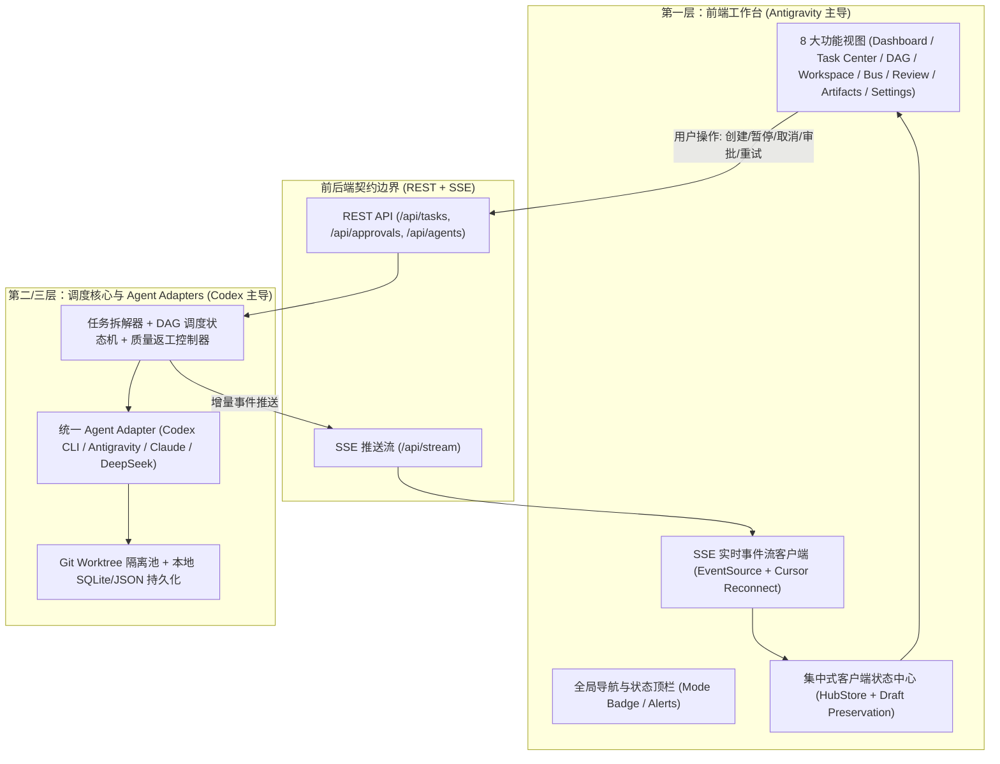

# Multi-Agent Collaboration Hub — 前端技术方案与实施计划（`docs/frontend-plan.md`）

**文档版本：** V1.0  
**负责人：** Antigravity（首席前端工程师 + UI/UX 设计负责人 + 浏览器集成测试负责人）  
**协作对象：** OpenAI Codex（首席后端工程师 + 系统架构负责人 + Agent 编排引擎负责人）

---

## 一、前端总体设计原则

1. **工程控制平面优先，而非聊天窗口：** 界面核心是**任务拆解（DAG）、状态监控（Kanban + Agent Runs）、上下文传递（Message Bus）、质量门禁（Review & Approval）与成果验收（Artifacts）**。
2. **严格区分模拟（Mock）与真实运行（Live）：** 每个实体（`Task`、`Subtask`、`AgentRun`、`Message`、`Artifact`）均携带 `executionMode: 'mock' | 'live'` 属性，UI 顶部及卡片级均渲染显著的 `[MOCK SIMULATOR]` 或 `[LIVE RUNTIME]` 标签。
3. **不绑定单一模型厂商：** 前端仅消费统一契约（`packages/shared/src/types.ts`），无论是 OpenAI Codex CLI、Google Antigravity、Claude Code 还是未来的 DeepSeek Harness，均通过统一的 `Agent` 与 `AgentRun` 模型渲染。
4. **状态切换零丢失：** 采用集中式客户端状态存储（Store）结合后端快照 + SSE 增量流，用户在看板、流程图、日志终端、代码审查之间任意切换时，表单草稿、筛选条件、日志滚动位置与任务状态均保持完整。

---

## 二、推荐前端技术栈与目录规划

基于开源审查结论与本机环境（macOS + Node.js v24.21.0），推荐采用以下技术路线：

- **核心框架：** React 19 + TypeScript 5（与 `agetor` 对齐，兼顾类型安全与组件复用）
- **构建与本地服务：**
  - **阶段一（原型验证与零依赖即开即用）：** 使用原生 Node.js HTTP + SSE 服务（`apps/web/server.mjs`）托管模块化前端应用与本地状态机 API，无需等待大型外部包构建即可在本地秒级启动并完成浏览器端到端验证。
  - **阶段二（工程化扩展）：** Vite + Tailwind CSS + `@dnd-kit`（看板拖拽）+ `@xyflow/react`（DAG 视图）。
- **通信机制：** RESTful JSON API（命令操作）+ Server-Sent Events (`EventSource /api/stream`)（实时状态、子任务进度、日志行与 Agent 间消息推送）。

### 前端源码目录结构（`apps/web/`）

```text
multi-agent-hub/
├── apps/
│   └── web/
│       ├── server.mjs                 # 本地可运行服务器 + REST/SSE Mock 编排引擎（Node v24 原生运行）
│       ├── public/
│       │   ├── index.html             # 多 Agent 协同平台主界面外壳
│       │   ├── styles.css             # 工业级深色开发工具主题样式系统
│       │   └── app.js                 # 前端响应式 Store、SSE 客户端、8 大视图渲染与交互控制器
│       └── src/                       # 面向正式构建的 TypeScript 模块化源码
│           ├── state/
│           │   └── hubStore.ts        # 集中式前端状态管理与 SSE 事件归约器 (Reducer)
│           └── components/
│               ├── TaskComposer.tsx   # 任务发布与自动拆解预览组件
│               ├── KanbanBoard.tsx    # 多列任务状态看板组件
│               ├── WorkflowDag.tsx    # 子任务依赖关系 DAG 视图组件
│               └── ReviewPanel.tsx    # 代码 Diff 审查与质量门禁审批组件
├── packages/
│   └── shared/
│       └── src/
│           └── types.ts               # 前后端共享的 TypeScript 核心实体与接口契约
├── docs/
│   ├── open-source-evaluation.md      # A-01 开源项目审查报告
│   ├── frontend-plan.md               # A-01/A-02 前端技术方案与实施计划（本文档）
│   ├── ui-pages.md                    # A-02 页面结构、功能与交互说明
│   ├── frontend-api-requirements.md   # A-03 前端对后端的数据与接口需求
│   ├── api-contract.md                # A-03 前后端正式 API 契约文档
│   └── codex-tasks.md                 # 需 Codex 配合完成的后端开发任务单
├── tests/
│   └── verify-prototype.mjs           # 自动化接口与状态流转集成验证脚本
└── AGENTS.md                          # Antigravity 与 Codex 双 Agent 协作宪章
```

---

## 三、架构分层与数据流设计



---

## 四、分阶段实施计划

### 第一阶段（当前阶段：技术审查、契约制定与可运行原型）
- **[已完成] 任务 A-01：** 完成 `agetor`、`shep`、`vibe-kanban` 源码结构与技术栈审查，输出 `docs/open-source-evaluation.md`。
- **[已完成] 任务 A-02：** 设计涵盖 8 大核心模块的产品信息架构与页面交互规范，输出 `docs/ui-pages.md`。
- **[已完成] 任务 A-03：** 定义 7 大核心实体（`Task`, `Subtask`, `Agent`, `AgentRun`, `Message`, `Artifact`, `Approval`）、结构化错误码与状态转换规则，输出 `packages/shared/src/types.ts` 与 `docs/frontend-api-requirements.md`。
- **[进行中] 任务 A-04：** 在 `apps/web/` 实现可本地启动、支持完整闭环操作（发布任务 → 自动拆解 → 多 Agent 执行日志/消息总线 → 模拟异常/超时重试 → Diff 审批/打回返工 → 成果预览）的交互原型，并执行浏览器与自动化验证。

### 第二阶段（与 Codex 后端联调与真实 CLI 接入）
1. **接入 Codex 实现的真实 SQLite 持久化与 Git Worktree 管理器**（对应后端任务 `C-01`、`C-02`）。
2. **联调真实 `CodexAdapter` 本地子进程流式输出**（对应后端任务 `C-03`），将前端顶部开关从 `MOCK SIMULATOR` 切换至 `LIVE RUNTIME` 验证真实日志流与退出码处理。
3. **联调自动测试与失败返工状态机**（对应后端任务 `C-05`），在浏览器中验证真实 Pytest/Vitest 失败时自动触发 Agent 返工。

### 第三阶段（多 Agent 深度协同与跨平台打磨）
1. 完善行级 Diff 评论直接引用回传给指定 Agent 的交互。
2. 接入更多合法授权的本地 CLI Agent（如 DeepSeek Harness 验证通过后接入）。
3. 开展高负载多 Agent 并发（4+ Agent 同时输出日志）下的前端虚拟滚动与性能优化。

---

## 五、验证状态与风险说明

- **已验证：**
  - 前后端共享 TypeScript 数据模型（`packages/shared/src/types.ts`）已建立。
  - 原型架构采用 Node.js 标准库提供 REST + SSE 服务，完全规避了沙箱离线环境无法执行 `npm install` 或缺少 `bun` 的阻碍。
- **待 Codex 配合验证：**
  - 真实 `git worktree add` 在并发任务下的锁竞争处理及 `codex exec --json` 的真实流式绑定（详见 `docs/codex-tasks.md`）。
